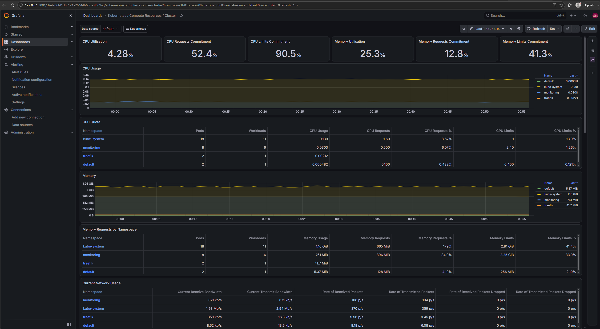
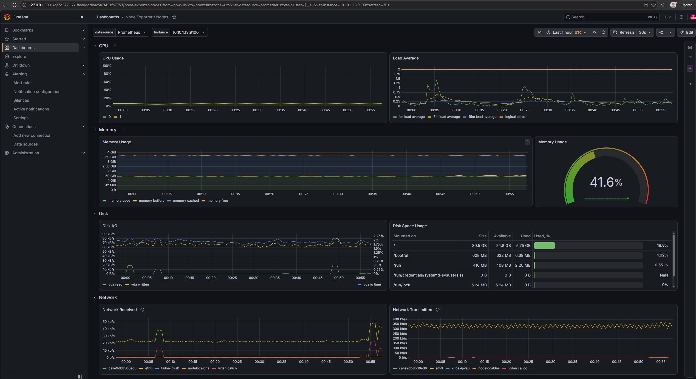
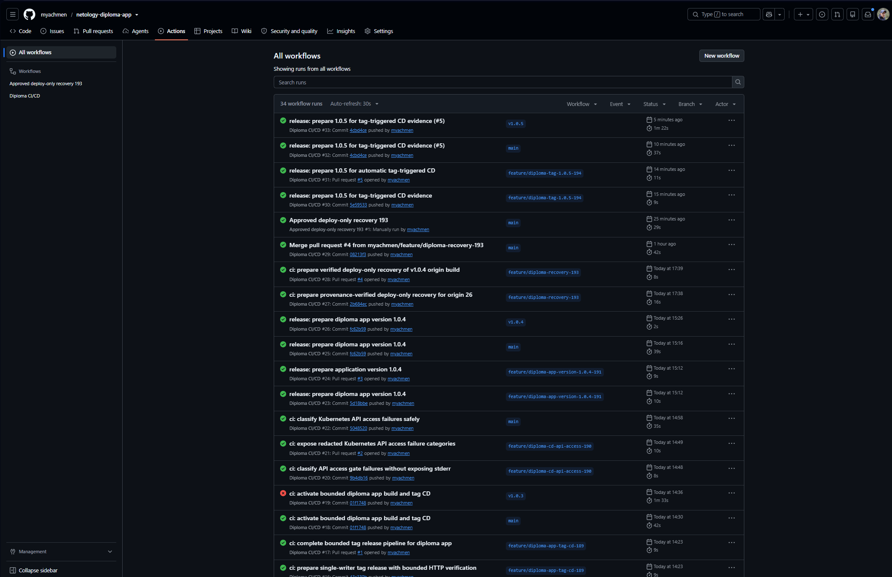

# Дипломный проект: DevOps-инфраструктура в Yandex Cloud

> **Состояние проекта на 7 ноября 2026 года:** инфраструктура и Kubernetes-кластер были развёрнуты; приложение и мониторинг проверены. Автоматический выпуск версии 1.0.5 по Git-тегу завершился успешно.
> Проверки и скриншоты отражают состояние на момент их получения. Стенд не планируется поддерживать постоянно работающим; условия доступа и повторной демонстрации приведены ниже.
>
> **Основа проекта:** [дипломное задание Нетологии «Дипломный практикум в Yandex.Cloud»](https://github.com/netology-code/devops-diplom-yandexcloud).

## Цель проекта

Создать воспроизводимую инфраструктуру в Yandex Cloud, развернуть в ней Kubernetes, опубликовать тестовое контейнерное приложение, организовать мониторинг и настроить автоматизированные процессы сборки, доставки приложения и управления инфраструктурой.

Кластер Kubernetes установлен самостоятельно на ВМ с помощью Ansible и Kubespray, без использования управляемого Kubernetes-сервиса.

## Состояние выполнения

| Этап задания | Состояние | Результат и дальнейшие действия |
|---|---|---|
| 1. Создание облачной инфраструктуры | Конфигурация готова, развёртывание проверялось ранее | Создание служебных ресурсов и основной инфраструктуры разделено; состояние хранится в S3. Terraform pipeline № 6 успешно применил сохранённый план без изменения управляемых ресурсов. Полный цикл восстановления с нуля ещё предстоит подтвердить. |
| 2. Создание Kubernetes-кластера | Развёрнут и проверялся ранее | Ansible/Kubespray, три ВМ. Ранее все три узла имели статус Ready; текущее состояние не проверялось. Worker-2 прерываемый. Точный путь к защищённому kubeconfig нужно уточнить. |
| 3. Создание тестового приложения | Реализовано | Отдельный репозиторий, Dockerfile и образ в Yandex Container Registry. Подтверждённая версия — 1.0.5. |
| 4. Мониторинг, приложение и автоматизация Terraform | Реализованы и подтверждены датированными проверками | Prometheus, Grafana, Alertmanager, экспортёры метрик и дашборды Kubernetes. Условия доступа для проверки описаны ниже; ссылку на скриншот Terraform pipeline ещё нужно добавить. |
| 5. CI/CD приложения | Автоматический выпуск по тегу подтверждён | Выпуск v1.0.5: тестирование, сборка, публикация образа и развёртывание успешны; приложение вернуло HTTP 200 и ожидаемую версию HTML-страницы. |

Конфигурационные файлы показывают устройство стенда, а датированные проверки и снимки экрана — результаты его работы. Они не подтверждают доступность сервисов в настоящий момент.

## Архитектура

### Облачная сеть

В Terraform описаны VPC `diplom-network` и три подсети в разных зонах доступности:

| Подсеть | Зона | CIDR |
|---|---|---|
| `diplom-subnet-a` | `ru-central1-a` | `10.10.1.0/24` |
| `diplom-subnet-d` | `ru-central1-d` | `10.10.2.0/24` |
| `diplom-subnet-e` | `ru-central1-e` | `10.10.3.0/24` |

При описанном развёртывании ВМ размещались в первой и второй подсетях; третья подсеть создана как часть облачной инфраструктуры. Узлы Kubernetes распределены по двум зонам доступности.

### Виртуальные машины Kubernetes

Таблица и адреса ниже относятся к ранее развёрнутому стенду. На 7 ноября 2026 года текущее состояние ВМ не проверялось. Прерываемый узел worker-2 ранее мог находиться в состоянии NotReady.

| Имя | Роль | Зона | Внутренний IP | vCPU | RAM | Диск |
|---|---|---|---|---:|---:|---:|
| `k8s-control-1` | Управляющий узел / etcd | `ru-central1-a` | `10.10.1.12` | 2 | 4 ГБ | 30 ГБ |
| `k8s-worker-1` | Worker | `ru-central1-d` | `10.10.2.28` | 2 | 6 ГБ | 50 ГБ |
| `k8s-worker-2` | Worker | `ru-central1-d` | `10.10.2.34` | 2 | 6 ГБ | 50 ГБ |

ОС узлов — Ubuntu 22.04 LTS. Для `k8s-worker-1` был закреплён публичный IP `158.160.190.231` после устранения проблем с исходящими соединениями. Публичные IP других узлов, выделяемые динамически, не фиксируются в этом документе.

В учебной конфигурации управляющая машина подключается к рабочим узлам по SSH через управляющий узел (`ProxyJump`). Выделенного bastion-хоста нет.

## Этап 1. Подготовка инфраструктуры Terraform

Terraform-конфигурации разделены на два независимых каталога:

- [`terraform/bootstrap/`](terraform/bootstrap/) — сервисная учётная запись, права IAM, статический ключ доступа и бакет Object Storage для состояния Terraform.
- [`terraform/infrastructure/`](terraform/infrastructure/) — S3-бэкенд, VPC, подсети, группы безопасности и три ВМ Compute Cloud.

Основная конфигурация использует удалённое состояние в бакете `netology-diplom-tfstate-myachmen`, ключ `infrastructure/terraform.tfstate`. Ключи для доступа к S3-бэкенду получаются через выходные значения bootstrap-конфигурации и **не публикуются** в Git.

Для развёртывания использовались Terraform и Yandex Cloud CLI. При одной из ранних проверок после изменения публичного IP `k8s-worker-1` конфигурация и состояние Terraform были синхронизированы: контрольный `terraform plan` завершился сообщением `No changes`.

**Что ещё требуется проверить по заданию:** воспроизводимый полный цикл уничтожения и создания инфраструктуры без дополнительных ручных изменений, а также минимально необходимые права сервисной учётной записи. Известное ограничение SSH-доступа: в опубликованной конфигурации [`security.tf`](terraform/infrastructure/security.tf) порт 22 открыт для `0.0.0.0/0`.

## Этап 2. Установка и проверка Kubernetes

Кластер установлен через **Kubespray v2.29.1** (commit `0c6a29553f90c55cba5e0e359470321dc7cf7d29`) с управляющей виртуальной машины Ubuntu 22.04 LTS.

| Компонент | Версия / реализация |
|---|---|
| Kubernetes | `v1.33.7` |
| Kubespray | `v2.29.1` |
| Среда выполнения контейнеров | `containerd 2.1.5` |
| CNI | Calico (VXLAN) |
| ОС Kubernetes-узлов | Ubuntu 22.04 LTS |

Поверх Kubespray v2.29.1 используется профиль проекта: [group_vars](ansible/kubespray/group_vars/k8s_cluster.yml) содержит настройки containerd, Calico, IPVS и метрик, отличающиеся от стандартного примера. Подготовка описана в [профиле Kubespray](ansible/kubespray/) и [профиле защищённого inventory](ansible/kubespray-current/). Учётные данные и локальные файлы inventory с чувствительными параметрами не публикуются в Git.

Конфигурация и подробная инструкция:

- **[Развёртывание Kubernetes с помощью Kubespray](ansible/README.md)**;
- [Inventory Ansible](ansible/inventory/diplom/hosts.yaml);
- [Пример SSH-конфигурации](ansible/ssh_config.example).

### Проверки Kubernetes

После установки и повторного запуска ВМ были выполнены проверки ниже. Последующая проверка 4 ноября 2026 года также подтвердила работоспособность кластера. Это результаты прошлых проверок, а не сведения о текущем состоянии:

1. Ansible `ping` завершился успешно на всех трёх узлах.
2. `kubectl get nodes -o wide` показал три узла в состоянии `Ready`.
3. Системные поды в `kube-system`, включая Calico, CoreDNS, `kube-proxy` и компоненты управляющего узла, работали (`Running`, `1/1`).
4. Тестовый HTTP-запрос из пода на `k8s-worker-1` в под nginx на `k8s-worker-2` завершился с `HTTP_CODE=200`, что подтвердило межузловую связность через Calico. Временные тестовые поды после проверки удалены.

Команды просмотра состояния на управляющем узле:

```bash
sudo kubectl --kubeconfig=/etc/kubernetes/admin.conf get nodes -o wide
sudo kubectl --kubeconfig=/etc/kubernetes/admin.conf get pods --all-namespaces -o wide
```

**Примечание:** команды приведены как пример ранее использовавшегося доступа на управляющем узле. Позднее применялся отдельный защищённый kubeconfig с проверкой TLS. Нужно уточнить и документировать его расположение, в том числе соответствие ожидаемому в задании пути `~/.kube/config`. Содержимое kubeconfig и административные учётные данные публиковать нельзя.

Материалы проверки: [узлы](img/22-kubernetes-nodes.png), [Deployment и поды](img/23-kubernetes-deployment-pods.png), [Service и Ingress](img/24-kubernetes-service-ingress.png). Снимки отражают состояние на момент их получения.

## Этап 3. Тестовое приложение

Приложение на nginx отдаёт статическую HTML-страницу. Код размещён в [отдельном репозитории](https://github.com/myachmen/netology-diploma-app/tree/4cbd4ce0c69a6660d40692c22ede1cca217f515a); для сборки подготовлен [Dockerfile](https://github.com/myachmen/netology-diploma-app/blob/4cbd4ce0c69a6660d40692c22ede1cca217f515a/Dockerfile).
Подтверждённая версия — **1.0.5**, коммит исходного кода — `4cbd4ce0c69a6660d40692c22ede1cca217f515a`.

Образ успешного выпуска закреплён по неизменяемому OCI-дайджесту:

```text
cr.yandex/crpb1oihnpa2uai8m3mp/netology-diploma-app@sha256:0b99b6410f06de1e7aa10c196deb1115eae86b30f0a8a012d839f939b693a775
```

При выпуске по тегу v1.0.5 приложение успешно развернулось и вернуло HTTP 200 с ожидаемой версией HTML-страницы. Порядок предоставления доступа для проверки описан в разделе [о доступности стенда](#доступность-стенда-и-демонстрация-результатов).

## Этап 4. Мониторинг, приложение и управление Terraform

Для мониторинга использован Helm-чарт `kube-prometheus-stack` версии **92.17.0**: Prometheus, Grafana, Alertmanager, node-exporter и метрики Kubernetes. Сохранены [основные параметры Helm](ansible/helm/monitoring-values.yaml) и [инструкция по развёртыванию](ansible/helm/monitoring.md). Старые `kubernetes/monitoring/values.yaml` и отключённый Grafana ingress не нужно применять как дополнительные настройки или отдельное развёртывание.

По результатам проверки **4 ноября 2026 года** release `monitoring` имел ревизию 2; Prometheus собирал метрики с **28 доступных целей, недоступных не было** (28 UP / 0 DOWN), включая kube-proxy и etcd. Проверки Grafana и готовности Alertmanager возвращали HTTP 200. В инструкции сохранены более ранние сведения о проблемах сбора метрик; последующая проверка подтвердила их устранение. Текущее состояние сервисов здесь не утверждается.

На опубликованных снимках Grafana показаны заполненные панели состояния Kubernetes и Node Exporter: CPU, память, сеть, диски и другие метрики. Снимок Prometheus targets показывает несколько доступных целей; он сам по себе не подтверждает состояние всех 28 целей.




[Цели сбора метрик Prometheus](img/12-prometheus-targets.png) ·
[Watchdog в Alertmanager](img/15-alertmanager-alerts.png) ·
[Состояние Alertmanager](img/16-alertmanager-status.png).

Alertmanager принимал Watchdog. На снимке указан получатель `null`; внешняя доставка уведомлений не подтверждена. Кластерный режим Alertmanager отключён: использовался один экземпляр. В параметрах Helm для Prometheus задан `emptyDir`, а сохранение данных Grafana отключено (`persistence=false`); при пересоздании подов данные и несохранённые настройки могут быть потеряны.

Настроенный HTTP-маршрут: **ALB, порт 80 → рабочие узлы, NodePort 30080 → Traefik → Service → поды приложения**. Сохранены [конфигурация ALB](terraform/infrastructure/alb.tf), [параметры Traefik](ansible/helm/traefik-values.yaml) и [манифесты приложения](kubernetes/app/). Работа маршрута подтверждалась прошлыми проверками. Файл `traefik-migration.md` описывает подготовку конфигурации и сам по себе не является свидетельством выполненной миграции.

### Автоматизация Terraform

Выбран вариант автоматического применения Terraform через CI/CD. **Исторический успешный запуск** выполнен из ветки `main` ([исходный workflow](https://github.com/myachmen/netology-devops-from-zero-homeworks/blob/7661c1b7535716f211e27be67c542d19d6ebbe8a/.github/workflows/terraform-automation.yml)). Перенос в `diplom-yandexcloud` подготовлен, но **производственный workflow ещё не включён**: [кандидат](ci/terraform/terraform-automation.yml.inert), [план переключения](docs/TERRAFORM_BRANCH_MIGRATION.md), [офлайн-проверки](.github/workflows/terraform-offline-tests.yml).

Сохранённые скриншоты подтверждают успешный запуск **Terraform automation № 6**: сохранённый план применён без изменения 14 управляемых ресурсов, изменено одно выходное значение. Это подтверждает работу автоматизации, но не демонстрирует создание всех ресурсов с нуля. Для сдачи осталось добавить проверенную ссылку на сохранённый скриншот именно Terraform pipeline. Новый запуск Terraform ради оформления документа не требуется.

## Этап 5. CI/CD приложения

[Workflow приложения](https://github.com/myachmen/netology-diploma-app/blob/4cbd4ce0c69a6660d40692c22ede1cca217f515a/.github/workflows/docker-publish.yml) выполняет:

- при коммите в `main` — тесты, сборку и публикацию образа;
- для веток разработки и Pull Request — только проверки без публикации образа и развёртывания;
- при создании нового тега, в первой попытке запуска — тесты, сборку и публикацию образа из точного коммита, развёртывание по дайджесту той же сборки, ожидание готовности и HTTP-проверку версии приложения.

На скриншотах от **7 ноября 2026 года** зафиксирован успешный выпуск `v1.0.5` из коммита `4cbd4ce0c69a6660d40692c22ede1cca217f515a`. В **Diploma CI/CD № 33** завершились все три задания — `test`, `build-and-push` и `deploy`; подтверждены готовность развёртывания, HTTP 200 и версия HTML-страницы **1.0.5**. Это автоматический выпуск по тегу, отдельный от более раннего ручного восстановления версии 1.0.4. Прежние ошибки и восстановление относятся к истории проекта.


[Снимок шага развёртывания](img/32-github-actions-tag-deploy-success.png) ·
[Снимок итогов проверки](img/33-github-actions-deploy-summary.png).

Workflow проверяет соответствие коммита, тега, версии и дайджеста образа. Для доступа к Kubernetes API используется ограниченный SSH-туннель с проверкой TLS/SNI и правами RBAC. Перед единственным атомарным изменением Deployment проверяется его исходное состояние; затем выполняются проверки готовности и HTTP-ответа. Развёртывания используют общую группу ограничения параллельности, временные файлы и туннель очищаются после работы. Автоматический повтор или откат не выполняется; повторный запуск либо новый выпуск требует отдельного согласования и проверки фактического состояния.

## Доступность стенда и демонстрация результатов

Дипломный стенд в Yandex Cloud был развёрнут; Kubernetes, приложение, мониторинг и CI/CD проверялись. Результаты сохранены в конфигурационных файлах, опубликованных скриншотах и датированных описаниях проверок.

Содержание облачных ресурсов требует оплаты, а дата проверки диплома заранее неизвестна. Поэтому стенд **не планируется поддерживать постоянно работающим**: к моменту проверки ссылки на приложение и Grafana могут быть недоступны. После завершения редактирования диплома планируется отдельно согласовать удаление облачных ресурсов для сокращения расходов. Текущее состояние облачных ресурсов не проверялось.

Если для проверки понадобится работающий стенд, можно предварительно договориться с преподавателем о повторной подготовке и развёртывании для демонстрации. Потребуются время и облачные расходы. Сохранённые исходники Terraform, Ansible, Kubernetes и CI/CD служат основой для восстановления, однако **полный цикл развёртывания с нуля ещё не подтверждён**. Мгновенное или полностью автоматическое восстановление не гарантируется.

Оригинальное задание предусматривает ссылки на приложение и Grafana с данными доступа, а также готовность показать создание ресурсов с нуля. Формат проверки по скриншотам с последующей демонстрацией необходимо **согласовать с преподавателем**; такое согласование пока не подтверждено, и скриншоты сами по себе не объявляются заменой этих требований.

Перед согласованной демонстрацией нужно подтвердить актуальные HTTP-адреса приложения и Grafana, способ разрешения имени Grafana и безопасно передать данные входа отдельно от репозитория. Доступ через `127.0.0.1` и локальный port-forward не является публичным доступом для преподавателя.

## Материалы для сдачи диплома

| Материал | Ссылка и сведения, которые нужно дополнить |
|---|---|
| Terraform и состояние инфраструктуры | [Служебные ресурсы](terraform/bootstrap/), [основная инфраструктура](terraform/infrastructure/). Нужно подтвердить готовность демонстрации с нуля и соответствие прав IAM принципу минимальных привилегий. |
| Автоматизация Terraform | [Исторический workflow в main](https://github.com/myachmen/netology-devops-from-zero-homeworks/blob/7661c1b7535716f211e27be67c542d19d6ebbe8a/.github/workflows/terraform-automation.yml), [неактивный кандидат](ci/terraform/terraform-automation.yml.inert), успешный запуск № 6 подтверждён скриншотами. Осталось добавить ссылку на сохранённый скриншот pipeline. |
| Ansible и Kubernetes | [Ansible](ansible/), [профиль Kubespray](ansible/kubespray/), [манифесты Kubernetes](kubernetes/). Нужно уточнить путь к защищённому kubeconfig. |
| Приложение и образ | [Репозиторий приложения](https://github.com/myachmen/netology-diploma-app/tree/4cbd4ce0c69a6660d40692c22ede1cca217f515a), [Dockerfile](https://github.com/myachmen/netology-diploma-app/blob/4cbd4ce0c69a6660d40692c22ede1cca217f515a/Dockerfile), OCI-дайджест в разделе 3. |
| Мониторинг | [Параметры Helm](ansible/helm/monitoring-values.yaml), дашборды и снимки Prometheus/Alertmanager в разделе 4. Это результаты проверок на момент их получения. |
| Приложение по HTTP, порт 80 | Адрес для проверки нужно подтвердить к согласованной демонстрации; постоянная доступность не обещается. |
| Grafana по HTTP, порт 80, и вход | Адрес, разрешение имени и безопасный способ передачи данных входа нужно согласовать для демонстрации. Учётные данные в README и PNG не публикуются. |
| Выпуск приложения по тегу | Снимки workflow и итогов в разделе 5; успешный запуск № 33 для v1.0.5 зафиксирован на скриншотах. Прямую ссылку на запуск можно добавить после проверки его точного адреса. |

Материалы архитектуры: [виртуальные машины](img/01-yandex-cloud-vms.png), [VPC](img/02-yandex-cloud-vpc.png), [ALB](img/03-yandex-cloud-alb.png), [проверка ALB](img/05-yandex-cloud-alb-health.png). Снимки 17–21 относятся к прежним попыткам настройки CI/CD и не используются как основные подтверждения финального результата. Секреты, ключи, kubeconfig и состояние Terraform не публикуются.

---

*Рабочая ветка: `diplom-yandexcloud`. Отчёт относится только к дипломному проекту и не изменяет оглавление домашних работ в ветке `main`.*
