# Домашнее задание по теме "Как работает сеть в K8s" Ячмень Марк Викторович

## Задание 1. Создать сетевую политику или несколько политик для обеспечения доступа

1. Создать deployment'ы приложений frontend, backend и cache и соответсвующие сервисы.
2. В качестве образа использовать network-multitool.
3. Разместить поды в namespace App.
4. Создать политики, чтобы обеспечить доступ frontend -> backend -> cache. Другие виды подключений должны быть запрещены.
5. Продемонстрировать, что трафик разрешён и запрещён.

## Решение 1

Для выполнения домашнего задания будем использовать кластер из виртуальных машин, который мы подготовили в рамках предыдущей домашней работы.

Удалим конфигурацию текущего Kubernetes-кластера на master-ноде:

```
sudo kubeadm reset -f
```


Очистим сетевую конфигурацию:

```
sudo rm -rf /etc/cni/net.d/*
```

Эта команда удалит конфигурацию CNI, оставшуюся от Flannel.

Удалим интерфейс Flannel:

```
ip link show flannel.1
sudo ip link delete flannel.1
```


Проверим каталог с настройками CNI:

```
sudo ls -la /etc/cni/net.d/
```

Удалим содержимое этого каталога:

```
sudo rm -f /etc/cni/net.d/10-flannel.conflist
```

Проверим, что всё удалено:

```
sudo ls -la /etc/cni/net.d/
ip link show flannel.1
```


Проверим оставшиеся сетевые интерфейсы и удалим остаточный интерфейс `cni0`:

```
ip -br link
sudo ip link delete cni0
```


Подготавливим worker-ноды.
Выполним аналогичную очистку на четырёх worker-нодах.
На каждой из них (`k8s-worker-1` ... `k8s-worker-4`) последовательно выполним:

```
sudo kubeadm reset -f

sudo rm -f /etc/cni/net.d/10-flannel.conflist
sudo ip link delete flannel.1 2>/dev/null || true
sudo ip link delete cni0 2>/dev/null || true
```

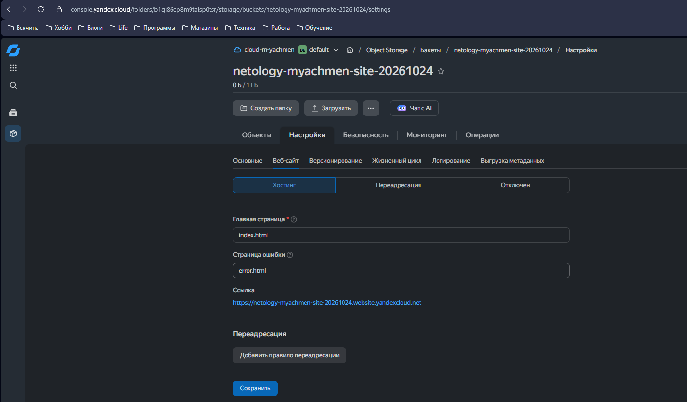

Проверим состояние:

```
hostname
sudo ls -la /etc/cni/net.d/
ip -br link
```

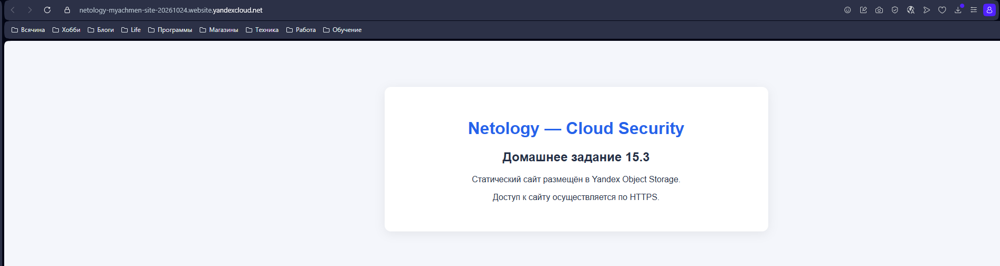

Проверим остаточную конфигурацию сети.
На ноде `k8s-master` выполним:

```
sudo ls -la /var/lib/cni/
sudo iptables-save | grep -E 'FLANNEL|CNI-|KUBE-' | head -30
```

На ней же проверим состояние containerd:

```
sudo systemctl is-active containerd
```

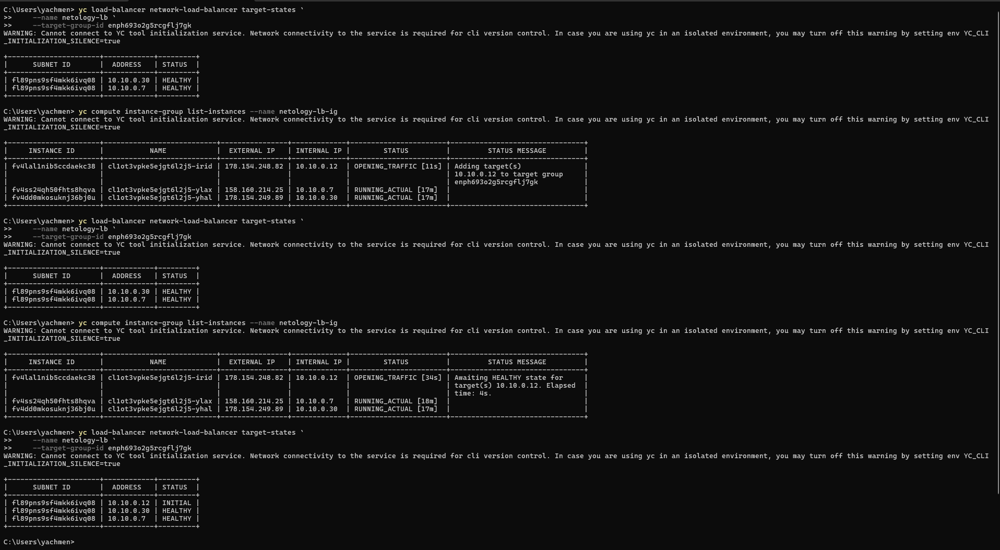

В выводе команд присутствуют остатки Flannel и старых сетевых правил Kubernetes.

Выполним очистку состояния CNI:

```
sudo rm -rf /var/lib/cni/flannel \
            /var/lib/cni/networks \
            /var/lib/cni/results
```

Проверим результат:

```
sudo ls -la /var/lib/cni/
```

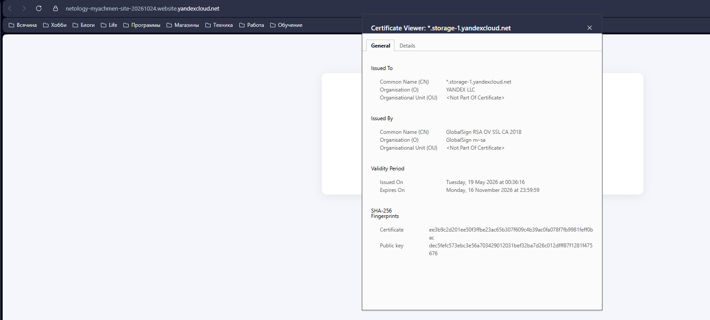

Выполним очистку CNI на worker-нодах.
На каждой из них (`k8s-worker-1` ... `k8s-worker-4`) последовательно выполним те же команды.

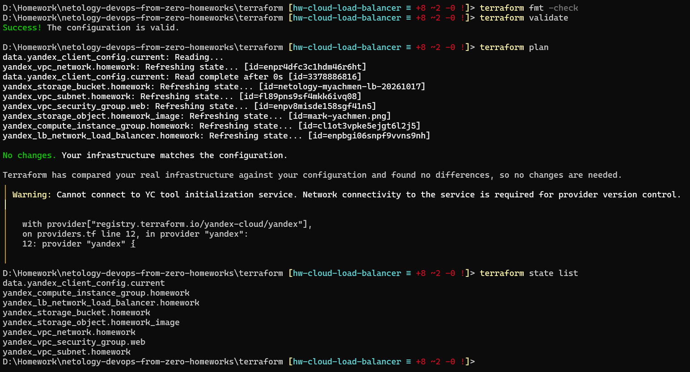

Для очистки правил iptables выполним перезагрузку виртуальных машин со следующей проверкой:

```
vagrant reload --no-provision
```

После перезагрузки выполним проверку:

```
ip -br link
sudo iptables-save | grep -E 'FLANNEL|CNI-|KUBE-' | head -30
sudo systemctl is-active containerd
```
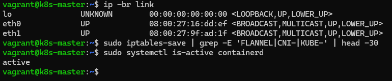

Выполним инициализацию Kubernetes:

```
sudo kubeadm init \
  --apiserver-advertise-address=192.168.57.10 \
  --control-plane-endpoint=192.168.57.10:6443 \
  --pod-network-cidr=10.244.0.0/16 \
  --service-cidr=10.96.0.0/12
```

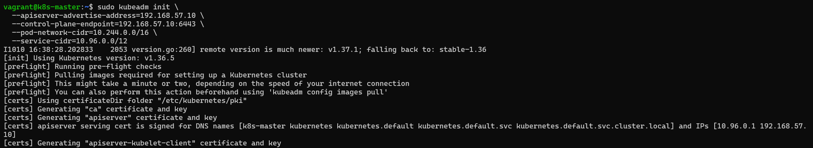

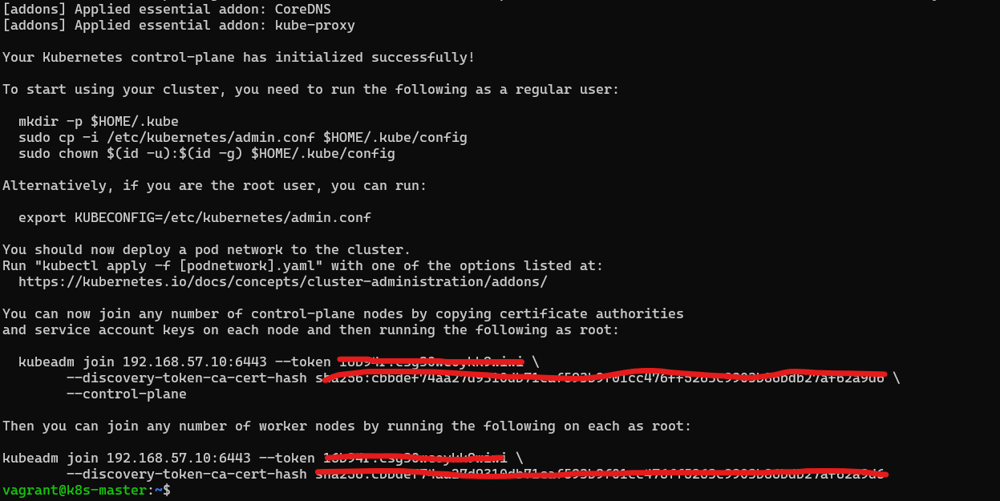

Настроим `kubectl` на ноде `k8s-master`.
После kubeadm reset и повторной инициализации старый файл ~/.kube/config мог остаться от предыдущего кластера. Поэтому заменим его актуальной конфигурацией:

```
mkdir -p "$HOME/.kube"
sudo cp /etc/kubernetes/admin.conf "$HOME/.kube/config"
sudo chown "$(id -u):$(id -g)" "$HOME/.kube/config"
chmod 600 "$HOME/.kube/config"
```

Проверим доступ к Kubernetes API:

```
kubectl cluster-info
```

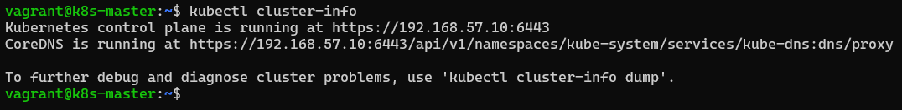

Проверим состояние нод и системных подов:

```
kubectl get nodes -o wide
kubectl get pods -n kube-system -o wide
```

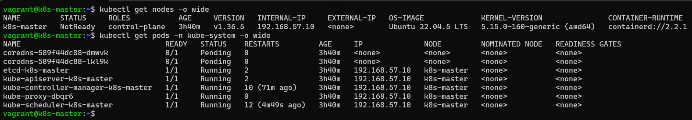

Приступим к установке Calico.

Проверим доступность ресурсов Calico:

```
curl -IL --max-time 20 \
  https://raw.githubusercontent.com/projectcalico/calico/master/manifests/tigera-operator.yaml
```

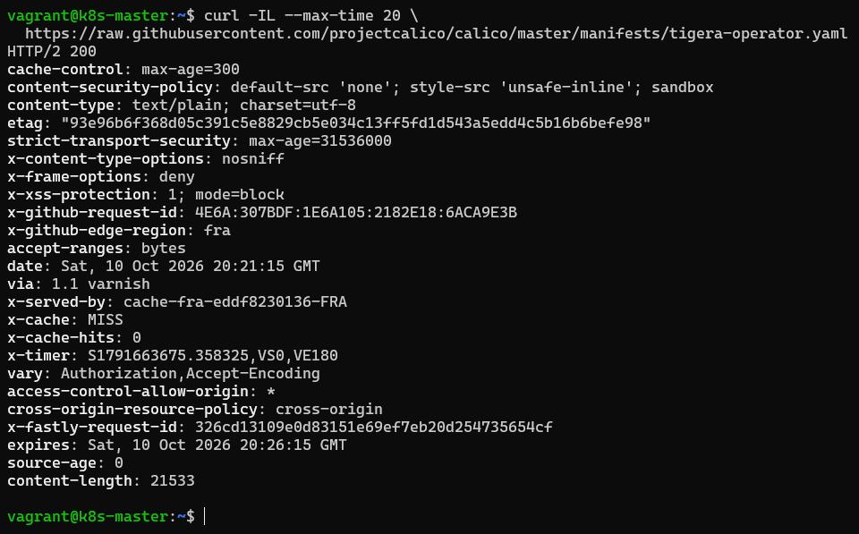

Создадим каталог для установочных файлов:

```
mkdir -p ~/calico-install
cd ~/calico-install
```

Cкачаем Tigera Operator:

```
curl -fL \
  https://raw.githubusercontent.com/projectcalico/calico/v3.33.0/manifests/tigera-operator.yaml \
  -o tigera-operator.yaml
```

Проверим файл:

```
ls -lh tigera-operator.yaml
head -n 15 tigera-operator.yaml
```

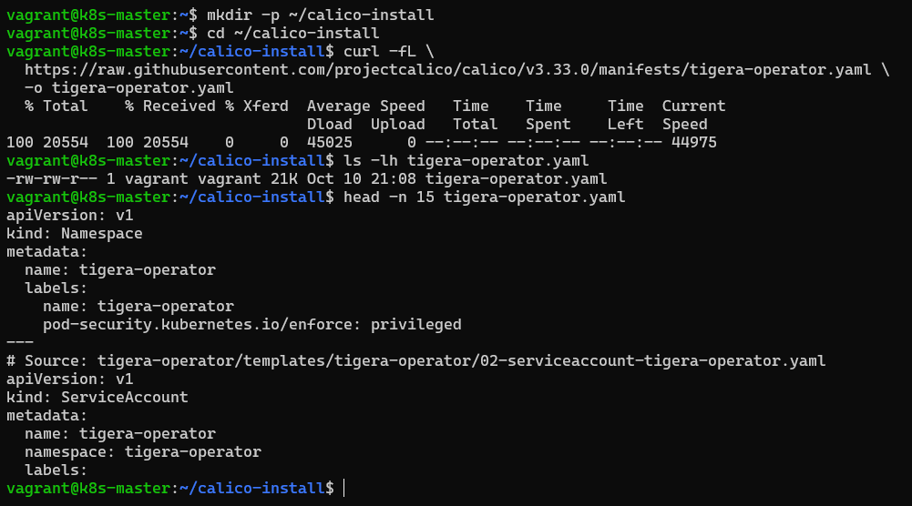

Скачиваем CRD Calico v3.33.0:

```
curl -fL \
  https://raw.githubusercontent.com/projectcalico/calico/v3.33.0/manifests/operator-crds.yaml \
  -o operator-crds.yaml
```

Проверим скачанный файл:

```
ls -lh operator-crds.yaml
```

Проверим количество определений CRD:

```
grep -c '^kind: CustomResourceDefinition' operator-crds.yaml
```

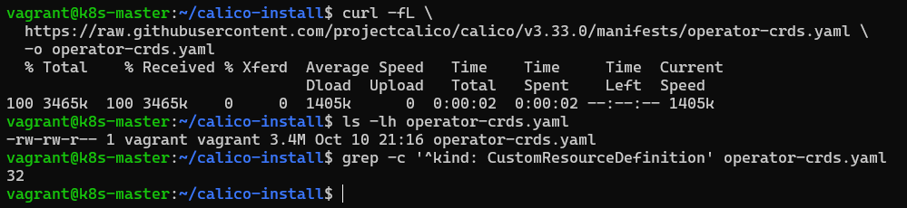

Устанавливим CRD.
На ноде `k8s-master`, находясь в каталоге `~/calico-install`, выполним:

```
kubectl apply --server-side -f operator-crds.yaml
```

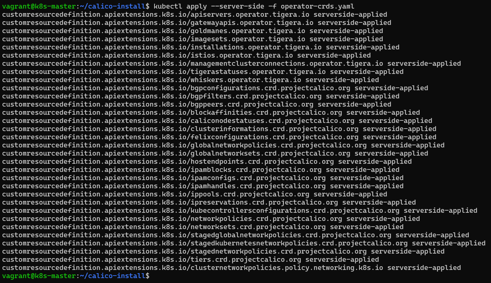

После завершения проверим:

```
kubectl get crd | grep operator.tigera.io
```

так же проверим, что Kubernetes зарегистрировал ресурс `Installation`:

```
kubectl get crd installations.operator.tigera.io
```

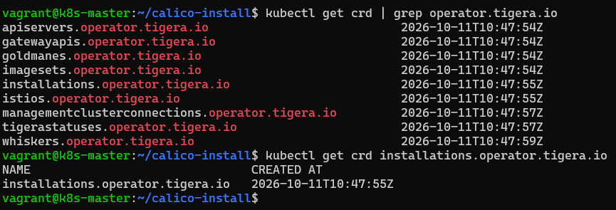

Устанавливаем Tigera Operator.
На ноде `k8s-master`, находясь в каталоге `~/calico-install`, выполним:

```
kubectl apply -f tigera-operator.yaml
```

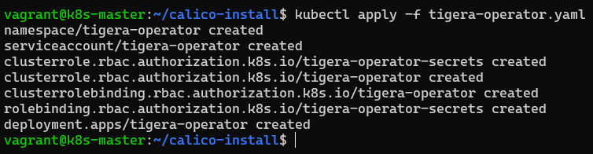

После установки проверим созданные ресурсы:

```
kubectl get deployment -n tigera-operator
kubectl get pods -n tigera-operator -o wide
```

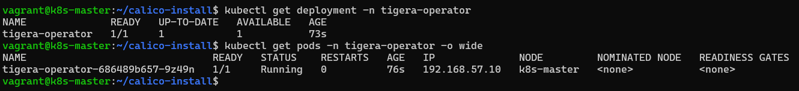

Дождёмся готовности оператора:

```
kubectl rollout status deployment/tigera-operator \
  -n tigera-operator \
  --timeout=180s
```

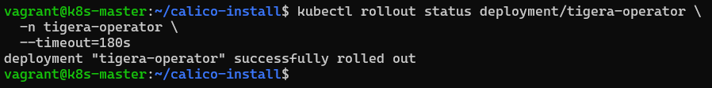

Создадим файл манифеста `custom-resources.yaml` следующего содержания:

```
apiVersion: operator.tigera.io/v1
kind: Installation
metadata:
  name: default
spec:
  registry: quay.io/
  calicoNetwork:
    bgp: Disabled
    ipPools:
      - cidr: 10.244.0.0/16
        encapsulation: VXLANCrossSubnet
        natOutgoing: Enabled
        nodeSelector: all()
    nodeAddressAutodetectionV4:
      interface: eth1
```

Проверим манифест:

```
kubectl apply --dry-run=server -f custom-resources.yaml
```

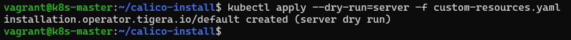

Устанавим Calico:

```
kubectl apply -f custom-resources.yaml
```

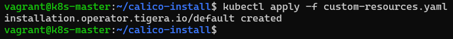

Проверим развёртывание:

```
kubectl get installation default -o yaml
kubectl get pods -A -o wide
```

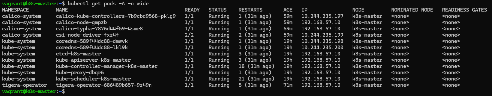

Проверим состояние master-ноды:

```
kubectl get nodes -o wide
```

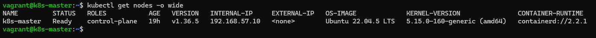

Приступим к подключению worker-нод.
На ноде `k8s-master` получим команду подключения:

```
kubeadm token create --print-join-command
```

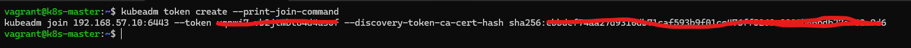

Подключимся к ноде `k8s-worker-1` и выполним команду подключение с использованием `sudo`:

```
sudo kubeadm join 192.168.57.10:6443 \
  --token <токен> \
  --discovery-token-ca-cert-hash sha256:<хеш>
```
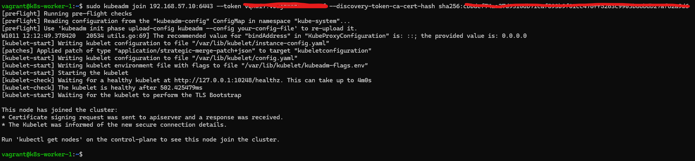

Подключимся к ноде `k8s-master` и проверим подключение:

```
kubectl get nodes -o wide
```

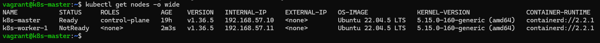

Проверим Calico на первой worker-ноде:

```
kubectl get pods -n calico-system -o wide
kubectl get nodes
```

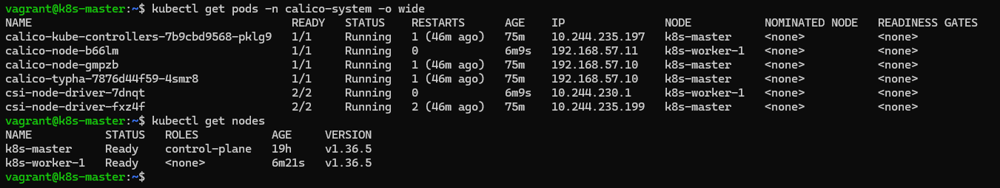

Выполним подключение оставшихся worker-нод/
Для этого выполним еа них ту же команду для подключения.

Выполним проверку всего кластера на ноде `k8s-master`:

```
kubectl get nodes -o wide
kubectl get pods -n calico-system -o wide
```

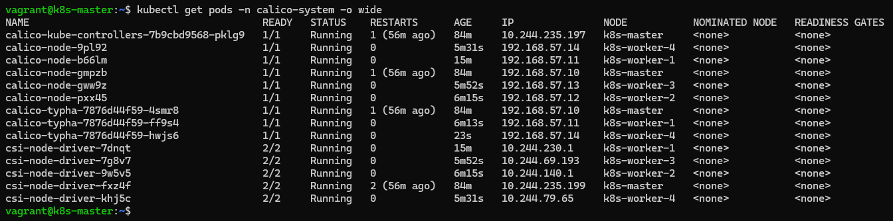

Приступим к работе с Kubernetes NetworkPolicy.
Создадим namespace `app`:

```
kubectl create namespace app
```

Проверим создание:

```
kubectl get namespace app
```

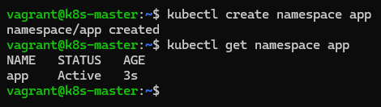

Приступим к созданию Deployment.
Создадим файл манифеста `frontend-deployment.yaml` следующего содержания:

```
apiVersion: apps/v1
kind: Deployment
metadata:
  name: frontend
  namespace: app
spec:
  replicas: 1
  selector:
    matchLabels:
      app: frontend
  template:
    metadata:
      labels:
        app: frontend
    spec:
      containers:
        - name: frontend
          image: wbitt/network-multitool:latest
          ports:
            - containerPort: 80
```

Создадим Service для frontend.
Создадим файл манифеста `frontend-service.yaml` следующего содержания:

```
apiVersion: v1
kind: Service
metadata:
  name: frontend
  namespace: app
spec:
  selector:
    app: frontend
  ports:
    - name: http
      protocol: TCP
      port: 80
      targetPort: 80
  type: ClusterIP
```

Создадим Deployment для backend.
Создадим файл манифеста `backend-deployment.yaml` следующего содержания:

```
apiVersion: apps/v1
kind: Deployment
metadata:
  name: backend
  namespace: app
spec:
  replicas: 1
  selector:
    matchLabels:
      app: backend
  template:
    metadata:
      labels:
        app: backend
    spec:
      containers:
        - name: backend
          image: wbitt/network-multitool:latest
          ports:
            - containerPort: 80
```

Создадим Service для backend.
Создадим файл манифеста `backend-service.yaml` следующего содержания:

```
apiVersion: v1
kind: Service
metadata:
  name: backend
  namespace: app
spec:
  selector:
    app: backend
  ports:
    - name: http
      protocol: TCP
      port: 80
      targetPort: 80
  type: ClusterIP
```

Создадим Deployment для cache.
Создадим файл манифеста `cache-deployment.yaml` следующего содержания:

```
apiVersion: apps/v1
kind: Deployment
metadata:
  name: cache
  namespace: app
spec:
  replicas: 1
  selector:
    matchLabels:
      app: cache
  template:
    metadata:
      labels:
        app: cache
    spec:
      containers:
        - name: cache
          image: wbitt/network-multitool:latest
          ports:
            - containerPort: 80
```

Создадим Service для cache.
Создадим файл манифеста `cache-service.yaml` следующего содержания:

```
apiVersion: v1
kind: Service
metadata:
  name: cache
  namespace: app
spec:
  selector:
    app: cache
  ports:
    - name: http
      protocol: TCP
      port: 80
      targetPort: 80
  type: ClusterIP
```

Для воспроизводимости конфигурации сохраним namespace YAML-манифест в репозитории.
Создадим файл манифеста `namespace.yaml` следующего содержания:

```
apiVersion: v1
kind: Namespace
metadata:
  name: app
```

Перенесём манифесты на Kubernetes master:

```
vagrant upload ..\k8s-network-policy /home/vagrant/k8s-network-policy k8s-master
```
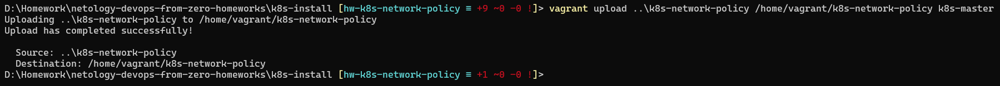

На ноде `k8s-master` проверим, что файлы загружены:

```
ls -la ~/k8s-network-policy/
```

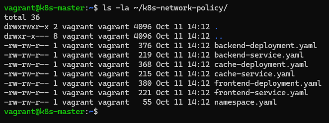

Выполним проверку манифестов Kubernetes:

```
kubectl apply --dry-run=server -f ~/k8s-network-policy/
```

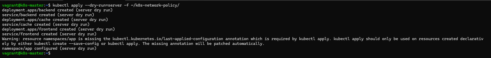

Предупреждение в выводе появилось потому, что namespace app мы первоначально создали императивной командой: `kubectl create namespace app`.
А теперь пытаемся управлять им декларативно через `kubectl apply`.
Kubernetes сообщает, что у существующего namespace отсутствует аннотация с предыдущей применённой конфигурацией. При обычном `kubectl apply` она будет добавлена автоматически.

Приступим к развёртыванию приложений.
На ноде `k8s-master` выполним:

```
kubectl apply -f ~/k8s-network-policy/
```

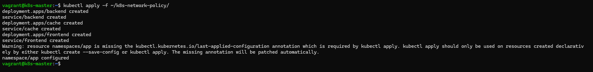

Проверим Deployment, а так же состояние Pod и Service:

```
kubectl get deployments -n app
kubectl get pods,services -n app -o wide
```

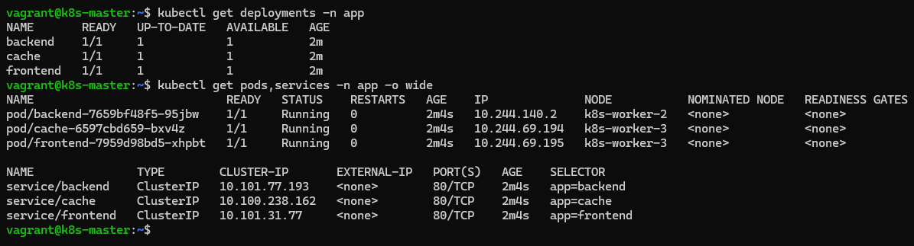

Приступим к проверке сетевых соединений.
Проверим соединение frontend → backend:

```
kubectl exec -n app deployment/frontend -- \
  curl -sS --connect-timeout 3 --max-time 5 http://backend
```

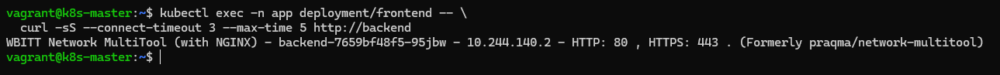

Проверим соединение frontend → cache:

```
kubectl exec -n app deployment/frontend -- \
  curl -sS --connect-timeout 3 --max-time 5 http://cache
```

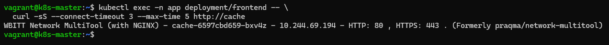

Проверим соединение backend → cache:

```
kubectl exec -n app deployment/backend -- \
  curl -sS --connect-timeout 3 --max-time 5 http://cache
```

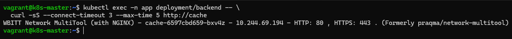

