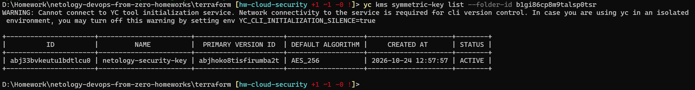
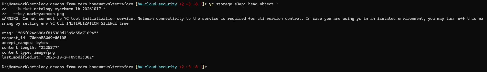
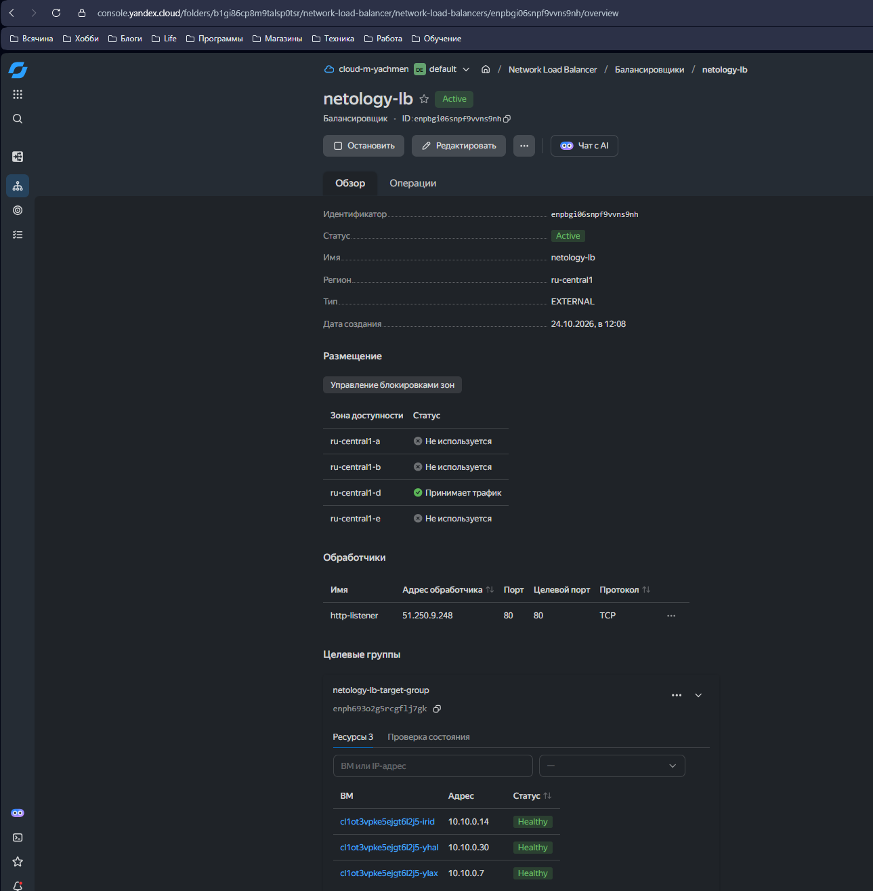
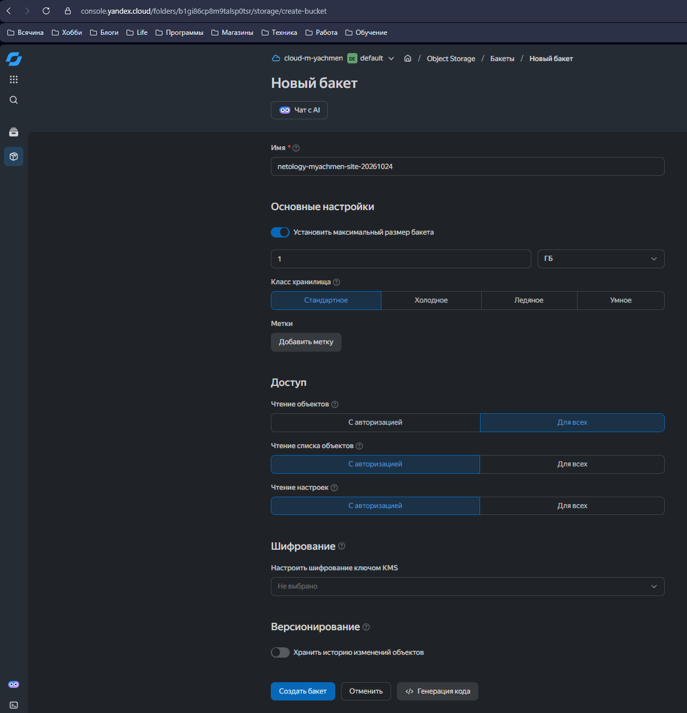

# Домашнее задание по теме "Организация сети" Ячмень Марк Викторович

## Задание 1. Yandex Cloud 

**Что нужно сделать**

1. Создать пустую VPC. Выбрать зону.
2. Публичная подсеть.

 - Создать в VPC subnet с названием public, сетью 192.168.10.0/24.
 - Создать в этой подсети NAT-инстанс, присвоив ему адрес 192.168.10.254. В качестве image_id использовать fd80mrhj8fl2oe87o4e1.
 - Создать в этой публичной подсети виртуалку с публичным IP, подключиться к ней и убедиться, что есть доступ к интернету.
3. Приватная подсеть.
 - Создать в VPC subnet с названием private, сетью 192.168.20.0/24.
 - Создать route table. Добавить статический маршрут, направляющий весь исходящий трафик private сети в NAT-инстанс.
 - Создать в этой приватной подсети виртуалку с внутренним IP, подключиться к ней через виртуалку, созданную ранее, и убедиться, что есть доступ к интернету.

## Решение 1

Для выполнения задания с помощью Terraform развернули сетевую инфраструктуру в Yandex Cloud.

Создали виртуальную сеть VPC `netology-network` с двумя подсетями:

- Публичная подсеть `192.168.10.0/24`, в которой размещены NAT-инстанс и виртуальная машина `public-vm` с публичными IP-адресами.
- Приватная подсеть `192.168.20.0/24`, в которой размещена виртуальная машина `private-vm` без публичного IP-адреса.

Для приватной подсети настроили таблицу маршрутизации, направляющую исходящий трафик через NAT-инстанс с внутренним адресом `192.168.10.254`.

Все ресурсы созданы в зоне доступности `ru-central1-d`.

### 1. Создание сетевой инфраструктуры

С помощью Terraform создали виртуальную сеть, публичную и приватную подсети, таблицу маршрутизации и группу безопасности.

Для описания сетевой инфраструктуры использовали файлы `network.tf`, `routes.tf` и `security.tf`.

### 2. Создание виртуальных машин

С помощью Terraform развернули три виртуальные машины:

- `nat-instance` — NAT-инстанс на базе образа Yandex Cloud Marketplace с внутренним IP-адресом `192.168.10.254`, предназначенный для обеспечения доступа приватной подсети в интернет.
- `public-vm` — виртуальная машина с Ubuntu 22.04, размещённая в публичной подсети `192.168.10.0/24`. Имеет публичный IP-адрес для подключения по SSH.
- `private-vm` — виртуальная машина с Ubuntu 22.04, размещённая в приватной подсети `192.168.20.0/24`. Имеет только внутренний IP-адрес `192.168.20.11`.

Конфигурация виртуальных машин описана в файле `compute.tf`, а получение образа Ubuntu 22.04 — в файле `images.tf`.

После применения Terraform-конфигурации все три виртуальные машины перешли в состояние `RUNNING`.

Созданные виртуальные машины в консоли Yandex Cloud:



### 3. Настройка маршрутизации через NAT-инстанс

Для обеспечения доступа приватной подсети в интернет создали таблицу маршрутизации `private-route-table`.

В таблицу добавили статический маршрут:

- Сеть назначения: `0.0.0.0/0`.
- Следующий узел (`next_hop_address`): `192.168.10.254`.

Таблицу маршрутизации привязали к приватной подсети `192.168.20.0/24`.

Таким образом, исходящий трафик приватной виртуальной машины направляется через NAT-инстанс, который выполняет трансляцию адресов и обеспечивает доступ в интернет без назначения публичного IP-адреса приватной ВМ.

Конфигурация маршрутизации описана в файле `routes.tf`, а привязка таблицы к подсети — в `network.tf`.

### 4. Проверка подключения и доступа в интернет

После развёртывания инфраструктуры проверили подключение к виртуальным машинам по SSH и доступность внешних ресурсов.

**Публичная виртуальная машина**

Подключились к `public-vm` по публичному IP-адресу:

```bash
ssh ubuntu@178.154.208.201
```

Проверили доступность интернета:

```bash
ping -c 4 -W 2 1.1.1.1
curl -4 -I --connect-timeout 5 --max-time 10 https://example.com
```

Проверка завершилась успешно: потери пакетов составили 0%, HTTPS-запрос вернул `HTTP/2 200`.

**Приватная виртуальная машина**

Для подключения к `private-vm`, не имеющей публичного IP-адреса, использовали SSH ProxyJump через публичную виртуальную машину:

```bash
ssh -J ubuntu@178.154.208.201 ubuntu@192.168.20.11
```

После подключения проверили внутренний IP-адрес и таблицу маршрутизации:

```bash
ip -4 addr show
ip route
```

Затем проверили доступность интернета:

```bash
ping -c 4 -W 2 1.1.1.1
curl -4 -I --connect-timeout 5 --max-time 10 https://example.com
```

Результат: потери пакетов составили 0%, DNS-разрешение работает, HTTPS-запрос вернул `HTTP/2 200`.

Таким образом, подтверждена возможность подключения к приватной виртуальной машине через публичную, а также доступ приватной ВМ в интернет через NAT-инстанс.

Результат проверки доступа в интернет с публичной виртуальной машины:



Результат проверки маршрутизации и доступа в интернет с приватной виртуальной машины:



### 5. Проверка работы NAT-инстанса

Для проверки работы NAT-инстанса подключились к нему по SSH:

```bash
ssh ubuntu@178.154.213.1
```

Проверили, что в операционной системе разрешена пересылка IPv4-пакетов:

```bash
sysctl net.ipv4.ip_forward
```

Получен результат:

```text
net.ipv4.ip_forward = 1
```

Затем проверили правила трансляции сетевых адресов:

```bash
sudo iptables -t nat -L POSTROUTING -n -v
```

В цепочке `POSTROUTING` обнаружено правило `MASQUERADE` для исходящего интерфейса `eth0`. Счётчики обработанных пакетов подтверждают использование правила.

Таким образом, проверена работа механизма NAT, обеспечивающего доступ приватной виртуальной машины в интернет.

Результат проверки NAT-инстанса:



### 6. Проверка Terraform-конфигурации

После развёртывания инфраструктуры проверили корректность Terraform-конфигурации.

Для проверки форматирования файлов выполнили:

```bash
terraform fmt -check
```

Команда завершилась успешно, ошибок форматирования не обнаружено.

Для проверки конфигурации выполнили:

```bash
terraform validate
```

Получен результат:

```text
Success! The configuration is valid.
```

Дополнительно выполнили:

```bash
terraform plan
```

Terraform подтвердил соответствие фактической инфраструктуры описанной конфигурации:

```text
No changes. Your infrastructure matches the configuration.
```

Таким образом, Terraform-конфигурация прошла проверку и соответствует развёрнутой инфраструктуре.
